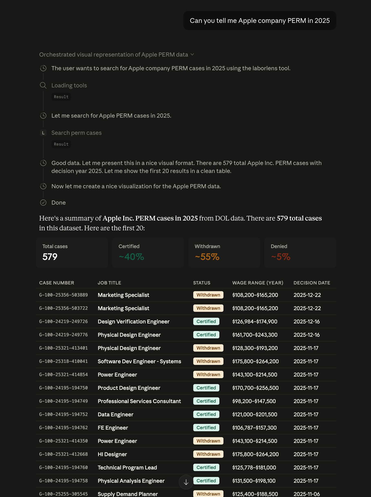

# LaborLens MCP

An MCP (Model Context Protocol) server that exposes [LaborLens](https://laborlens.fyi) — a U.S. Department of Labor prevailing wage and PERM labor certification search tool — as tools for Claude and other MCP-compatible AI assistants.



## Tools

| Tool | Description |
|---|---|
| `search_pwd_cases` | Search PWD cases by employer, location, job title, case number, or year |
| `search_perm_cases` | Search PERM labor certification cases with the same filters + decision year |
| `get_case` | Fetch full details for a case by its ID |
| `get_pwd_years` | List all years available in the PWD dataset |
| `get_perm_years` | List all years available in the PERM dataset |

## Requirements

- Python 3.14+
- [uv](https://docs.astral.sh/uv/)

## Setup

```bash
git clone https://github.com/blueandhack/LaborLens-MCP
cd LaborLens-MCP
uv sync
```

## Claude Desktop

Add to `~/Library/Application Support/Claude/claude_desktop_config.json`:

```json
{
  "mcpServers": {
    "laborlens": {
      "command": "/opt/homebrew/bin/uv",
      "args": ["run", "--directory", "/path/to/LaborLens-MCP", "python", "server.py"],
      "env": {
        "LABORLENS_URL": "https://laborlens.fyi"
      }
    }
  }
}
```

Restart Claude Desktop after saving.

## Environment Variables

| Variable | Default | Description |
|---|---|---|
| `LABORLENS_URL` | `https://laborlens.fyi` | Base URL of the LaborLens API |

## Data Source

Data comes from the [U.S. Department of Labor](https://www.dol.gov/agencies/eta/foreign-labor/performance) OFLC Performance Data disclosure files.
